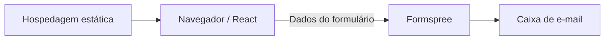
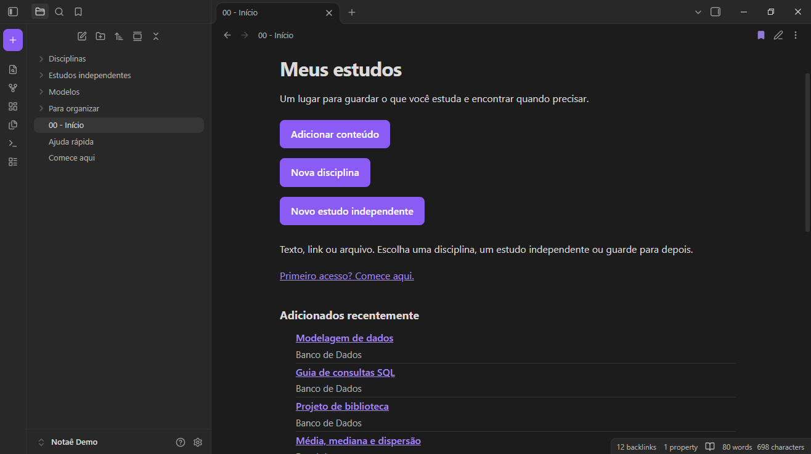

# Portfólio | Lukas Candeia


Portfólio de Lukas Candeia, estudante de Engenharia de Software na PUC Minas com foco em backend. Reúne projetos acadêmicos, estudos e trabalhos freelance para quem procura conhecer sua trajetória profissional.

## Status do projeto

Aplicação disponível para execução local. A publicação na nuvem e as capturas dos demais projetos estão pendentes.

## Índice

- [Links úteis](#links-úteis)
- [Funcionalidades](#funcionalidades)
- [Tecnologias utilizadas](#tecnologias-utilizadas)
- [Arquitetura](#arquitetura)
- [Instalação e execução](#instalação-e-execução)
- [Deploy](#deploy)
- [Estrutura de pastas](#estrutura-de-pastas)
- [Demonstração](#demonstração)
- [Testes](#testes)
- [Fontes e autoria](#fontes-e-autoria)

## Links úteis

- [Repositório no GitHub](https://github.com/LukCandeia/Portifolio-LukasCandeia)
- [Wireframes desktop e mobile no Figma](https://www.figma.com/design/XiiwqOVqEPktVu3hyc7EsA/Portif%C3%B3lio-2026?node-id=3-2)
- [Documentação do formulário](docs/FORMULARIO.md)
- Site publicado: endereço pendente.

## Funcionalidades

- Página responsiva em português brasileiro e inglês, com temas claro e escuro.
- Seções de apresentação, projetos, experiências, ferramentas e contato.
- Linha do tempo filtrável. Os projetos com mês confirmado aparecem em ordem de início. Os demais ficam agrupados pelo ano.
- Cards com tecnologias, detalhes e links para o GitHub.
- Contato por e-mail, WhatsApp, LinkedIn e GitHub. O formulário valida nome, e-mail e mensagem antes de enviar os dados ao Formspree.

## Tecnologias utilizadas

| Dependência                 | Uso                                                             |
| --------------------------- | --------------------------------------------------------------- |
| React e React DOM           | Componentes, estado e renderização no navegador                 |
| Vite e @vitejs/plugin-react | Servidor de desenvolvimento e build                             |
| Prettier                    | Formatação                                                      |
| JavaScript, HTML e CSS      | Lógica, estrutura e apresentação                                |
| Node.js e npm               | Ferramentas de desenvolvimento e execução dos testes            |
| Formspree                   | Recebimento dos dados do formulário e encaminhamento por e-mail |

As versões instaladas constam no package-lock.json. O layout usa CSS próprio, com a grade bento na apresentação e os cartões translúcidos nos dois temas.

## Arquitetura

O Vite gera HTML, CSS e JavaScript estáticos. O React renderiza as seções a partir dos dados locais. As preferências de tema e idioma ficam no navegador. O formulário faz uma requisição HTTPS ao Formspree, serviço responsável pelo envio ao destinatário configurado.



## Instalação e execução

Instale Node.js 22.12 ou superior e npm. Na raiz do repositório, execute:

```sh
npm ci
npm run dev
```

Abra o endereço mostrado pelo Vite. A configuração pública do formulário fica em src/config.js.

## Deploy

Execute npm run build e publique o diretório dist em uma hospedagem estática. Para conferir o build localmente, execute npm run preview após a compilação. Atualize o link em **Links úteis** quando o endereço público for verificado.

## Estrutura de pastas

```text
.
├── docs/                   Fontes e integração de contato
├── public/                 Ícone e capturas dos projetos
├── src/
│   ├── components/         Timeline, carrossel e contato
│   ├── App.jsx             Seções e preferências
│   ├── main.jsx            Inicialização do React
│   ├── content.js          Textos da página
│   ├── ui-copy.js          Textos dos controles e do formulário
│   ├── projects.js         Dados e links dos projetos
│   ├── timeline.js         Agrupamento cronológico
│   ├── contact.js          Requisição ao Formspree
│   └── styles.css          Layout, temas e estados de interação
├── tests/                  Testes de conteúdo, timeline e contato
├── index.html
└── vite.config.js
```

## Demonstração

A tela do Notaê no Obsidian é uma captura do projeto em uso. Fonte: [README do Notaê](https://github.com/LukCandeia/Notae#demonstração).



## Testes

```sh
npm run check
```

O comando roda os testes do Node.js e gera o build de produção. Os testes do formulário simulam respostas do serviço. A entrega na caixa de e-mail precisa ser conferida com um envio real.

## Fontes e autoria

- [Fontes das descrições dos projetos](docs/FONTES.md)
- [Modelo de README do professor João Paulo Aramuni](https://github.com/joaopauloaramuni/desenvolvimento-e-integracao-de-aplicacoes-web/blob/main/TEMPLATES/template_README.md)
- [Documentação do React](https://react.dev/), [Vite](https://vite.dev/) e [Formspree](https://help.formspree.io/)
- Lukas Candeia • [GitHub](https://github.com/LukCandeia) • [LinkedIn](https://www.linkedin.com/in/lukascandeia)
